# Duet architecture (as built)

How the code that exists today fits together. For what the system *should* do, see the
[functional spec](backend-functional-spec.md); for the build order, see the
[implementation plan](implementation-plan.md). For the wire format between the Hub and
the rig, see the [device protocol](device-protocol.md); for building the rig, see the
[rig guide](rig-guide.md).

## The big picture

Everything turns into one score format, the **DuetScore**. A score is checked against the
robot's physics and the pianist's level, repaired if needed, turned into timed plans, and
performed by the conductor through the device gateway to the rig.

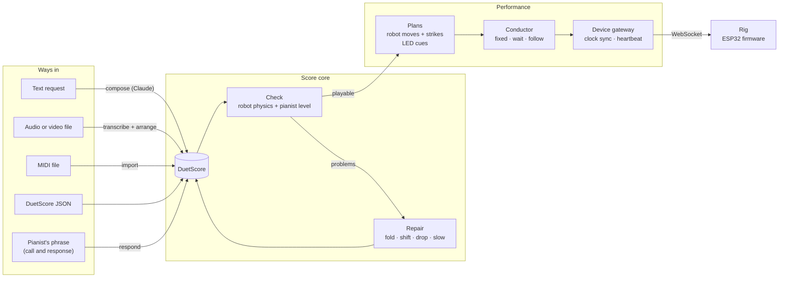

## Where it runs

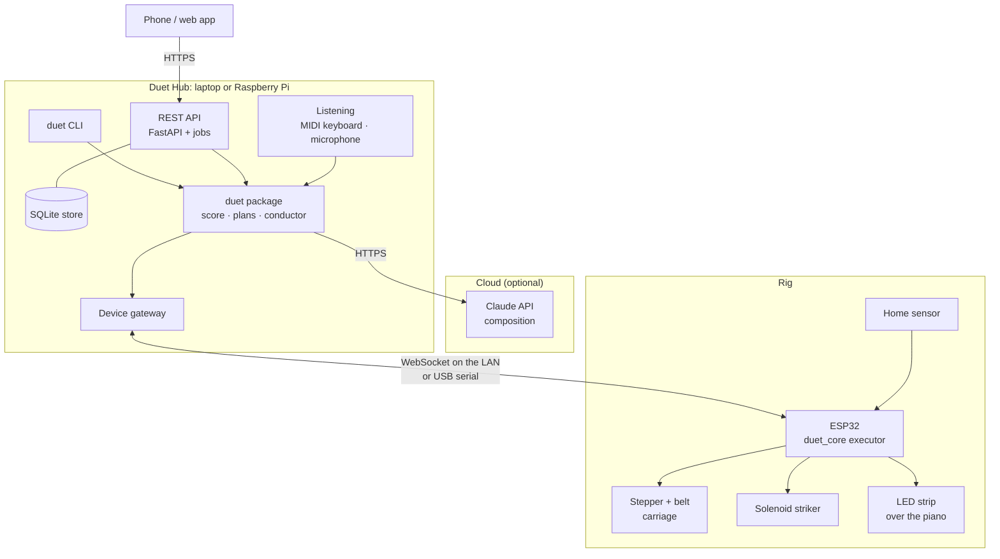

Real-time timing never depends on the internet: the Hub and the rig talk on the local
network, and every command is sent ahead of time with an absolute time stamp.

## Module map

All Python code is in `src/duet/`. Arrows mean "uses".

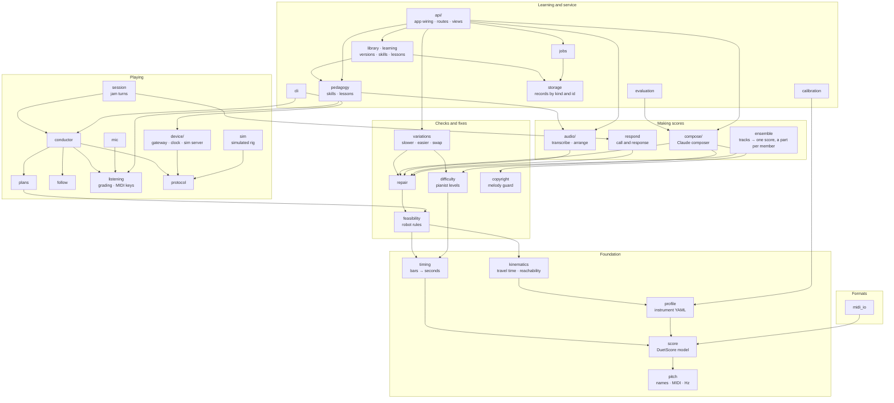

| Layer | Modules | One-line purpose |
|---|---|---|
| Foundation | `pitch`, `score`, `timing`, `profile`, `kinematics` | The vocabulary: notes, scores, time, instruments, motion physics |
| Checks and fixes | `feasibility`, `difficulty`, `repair`, `variations`, `copyright` | Can it be played? How hard is it? Make it playable, easier, original |
| Making scores | `compose/`, `audio/`, `respond`, `ensemble`, `midi_io` | Every way of getting a DuetScore |
| Playing | `plans`, `conductor`, `follow`, `listening`, `mic`, `session`, `protocol`, `sim`, `device/` | Turn a score into timed commands and listen to the pianist |
| Learning and service | `pedagogy`, `calibration`, `evaluation`, `library`, `learning`, `storage`, `api/`, `jobs`, `cli` | Skills, lessons, measuring the rig and the composer; the library and learning rules as plain functions over a store; the outside interfaces (`api/app.py` only wires; routes live in `api/routes/`, one module per area) |
| Firmware | `firmware/lib/duet_core/` (C++) | Runs timed commands on the rig and keeps the hardware safe |

## The score: one format for everything

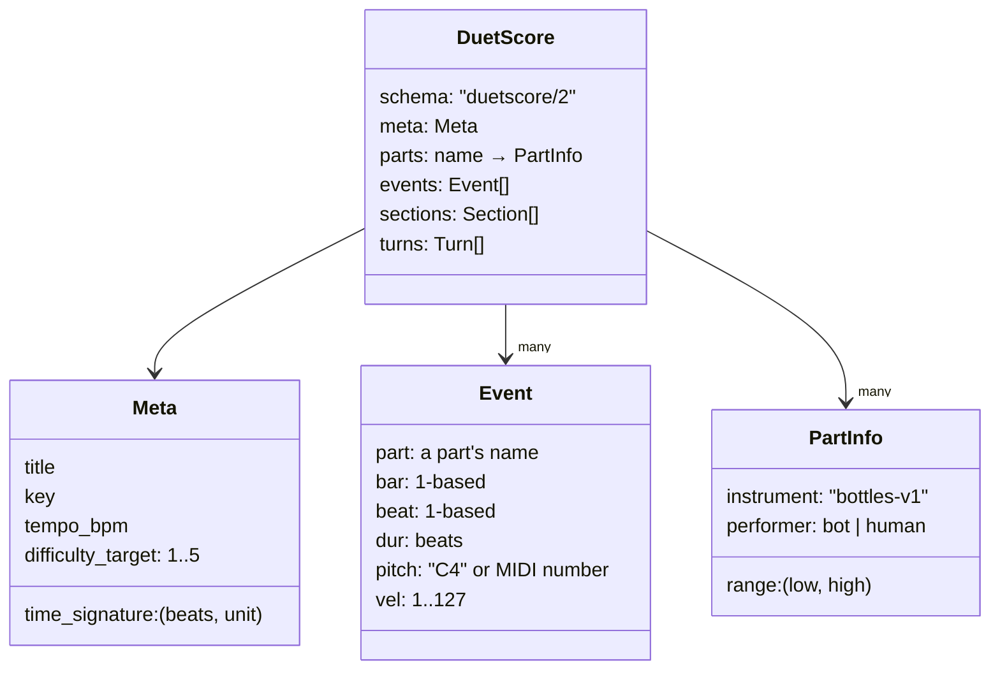

- Scores are **immutable** (frozen pydantic models). Every change makes a new score.
- Each part names an **instrument** (`duet.instruments`) and its **performer**: a bot or
  a human (`duet.performers`), which owns the rule for what it can play. Version-1 files
  (exactly "robot" and "pianist", with `instrument_profile`) are read as version 2.
- Code never asks for "the robot part". Things that make a duet (the composer, MIDI
  import, the arranger, call and response) make it for a `Duo` (part names and
  instruments as data); features made for duets (swap, teaching a part, live playing
  until step 1e) ask for `score.part_played_by("bot")`, which says clearly when a score
  is not a duet.
- Pitches are stored as MIDI numbers and written as names (`"E5"`), so JSON stays readable.
- `timing` is the only module that turns bars and beats into seconds.
- Claude never writes a DuetScore directly. It writes a smaller, strict **draft** JSON
  (`compose/draft.py`), and code converts it. That lets the API enforce the draft's shape.

## Check, repair, plan

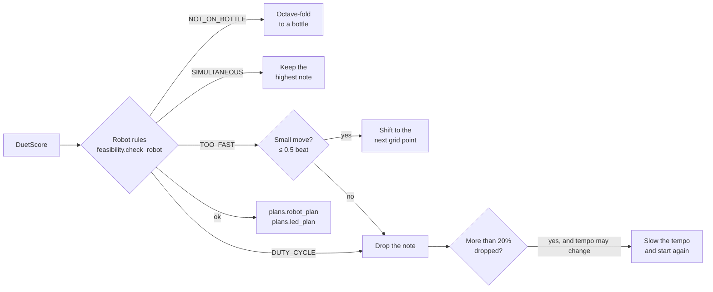

The robot rules come from the **reachability matrix**: the minimum time between strikes
on any two bottles, from the trapezoid motion model in `kinematics.py`. The same table is
put in Claude's prompt, so drafts are usually playable before any repair.

Reachability matrix for <code>bottles-v1</code> (ms between consecutive strikes)

| from \ to | C5 | D5 | E5 | F5 | G5 | A5 | B5 | C6 |
|---|---|---|---|---|---|---|---|---|
| **C5** | 60 | 305 | 465 | 625 | 785 | 945 | 1105 | 1265 |
| **D5** | 305 | 60 | 305 | 465 | 625 | 785 | 945 | 1105 |
| **E5** | 465 | 305 | 60 | 305 | 465 | 625 | 785 | 945 |
| **F5** | 625 | 465 | 305 | 60 | 305 | 465 | 625 | 785 |
| **G5** | 785 | 625 | 465 | 305 | 60 | 305 | 465 | 625 |
| **A5** | 945 | 785 | 625 | 465 | 305 | 60 | 305 | 465 |
| **B5** | 1105 | 945 | 785 | 625 | 465 | 305 | 60 | 305 |
| **C6** | 1265 | 1105 | 945 | 785 | 625 | 465 | 305 | 60 |

The diagonal is the solenoid's recovery time. Off the diagonal: the 30 ms pulse, then
travel, then 15 ms to settle. Regenerate with `reachability(robot_profile()).as_table()`.

### How a strike is planned

The carriage leaves **as late as possible**, so it waits at the last bottle while that
bottle rings. The solenoid fires early by the strike-to-sound latency, so the sound lands
on the beat.

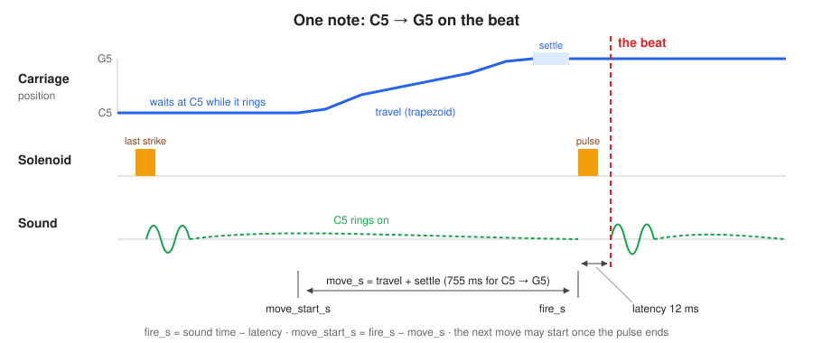

## The conductor

The conductor turns plans into device messages and streams them ahead of time. Every
part is played: each bot part's moves and strikes, each human part's light cues (the
first human part's lights also count everyone in). ``routes`` say which devices play
each part: ``one_rig(score, devices)`` for the usual single board, or a rig per part for
an ensemble. Two bot parts on one device are refused: one carriage cannot be in two
places. ``instruments`` are the ones in use (say, a calibrated rig), before the
built-in ones.

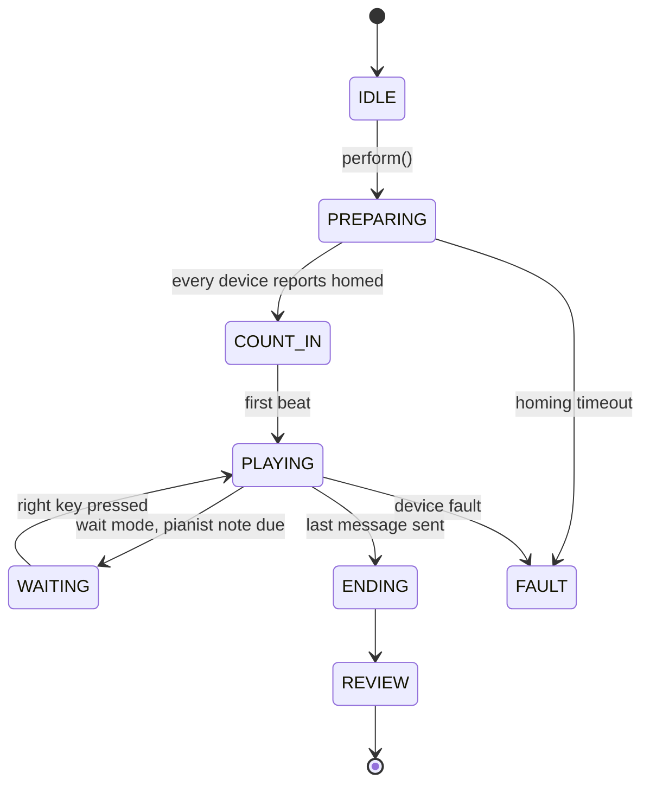

| Mode | Who sets the time | How it works | Lookahead |
|---|---|---|---|
| **Fixed** | The score | Every command at its planned time | 500 ms |
| **Wait** | The pianist | Commands up to the next pianist note are sent; later ones wait until the key is pressed, then shift by the wait | 500 ms |
| **Follow** | The pianist | Every command is timed through the follower's tempo map; speed-ups are capped by the robot's slack | 150 ms |
| **Call and response** | Turns | The pianist plays a phrase; the robot answers right after | 500 ms |
| **Ensemble** | The score | One stream for several rigs; each message goes to its own rig | 500 ms |

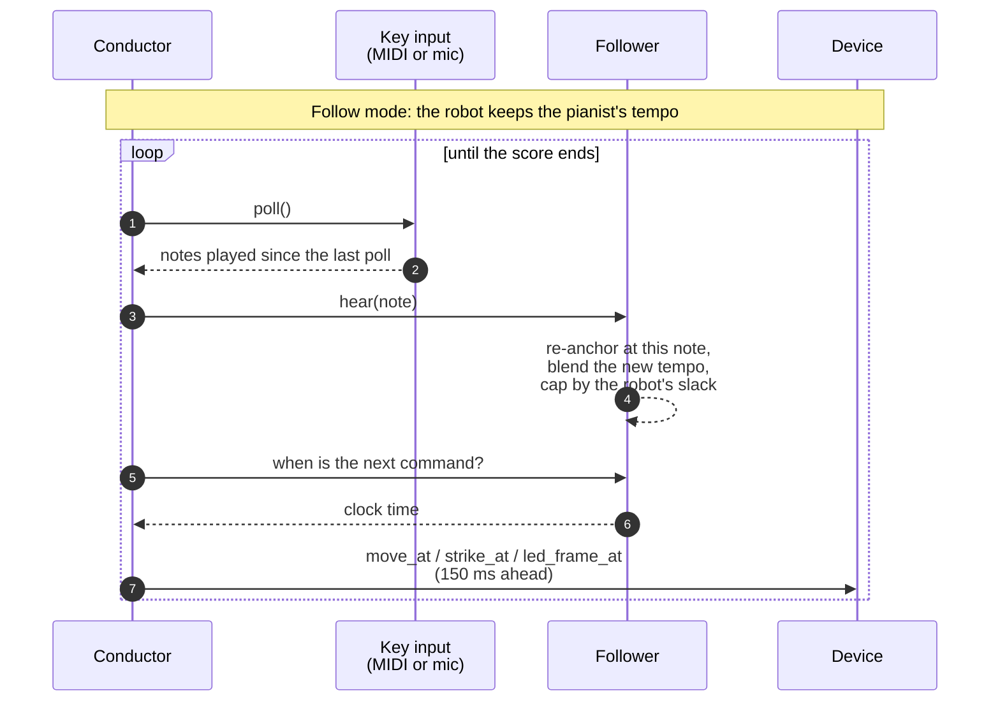

## Background jobs

Composition and transcription can take seconds to minutes, so the API can run them in
the background and stream progress.

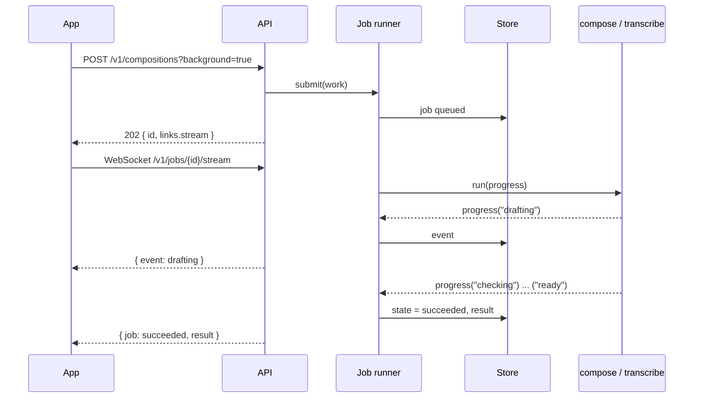

Jobs live in the store, so they work the same with the in-memory store and SQLite.

## Extension points

Each of these is a small interface with a fake implementation in the tests, so tests
never need the network, a GPU or hardware.

| Interface | Where | Real implementations | Test stand-in |
|---|---|---|---|
| `Composer.write(system, messages)` | `compose/service.py` | `ClaudeComposer` | `ScriptedComposer` |
| `Transcriber.transcribe(audio, sr)` | `audio/notes.py` | `PyinTranscriber`, `BasicPitchTranscriber` | synthesized audio |
| `Separator.separate(path)` | `audio/fullmix.py` | `DemucsSeparator` | `FakeSeparator` |
| `Store` (add, put, get, list, delete, update) | `storage.py` | `MemoryStore`, `SqliteStore` | both, in every API test |
| `Device.send(msg)` | `conductor.py` | `DeviceGateway` | `SimulatedRig` |
| `KeyInput` (poll, wait_for) | `listening.py` | `MidiKeys`, `MicKeys` | `SimulatedPianist`, `TempoPianist`, `PhrasePianist` |
| `Hal` (C++) | `firmware/lib/duet_core/src/duet_hal.hpp` | `Esp32Hal` | `SimHal` |

## Time

There is one clock on the Hub: `device.clock.hub_now_us()` (monotonic microseconds).

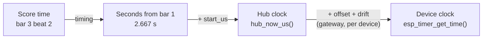

- Plans are in seconds from bar 1. The conductor adds the start time.
- The gateway converts Hub time to each device's own clock, so firmware never deals with
  offsets. See [device protocol: clock sync](device-protocol.md#clock-sync).

## How it is tested

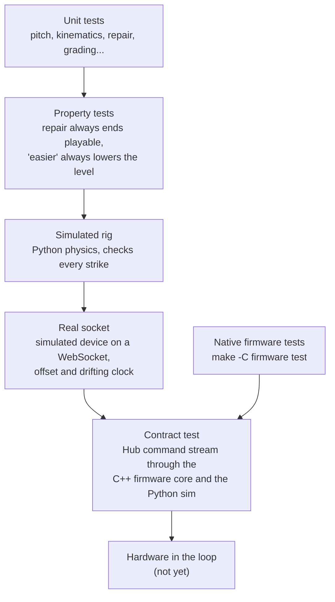

`make check` runs lint, every Python test and the native firmware tests. CI runs the same.
