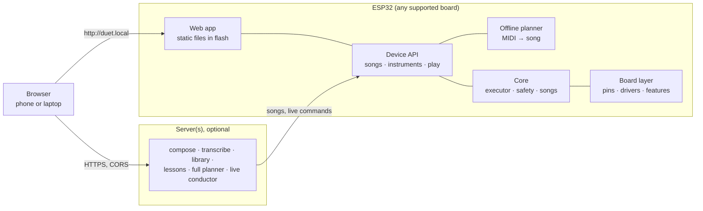

# Design: the ESP32 as the product, instruments as data, many boards

Status: agreed, being built in steps (see the plan at the end).

## Goals

1. **The ESP32's web page is the main interface.** The rig works with no PC: play
   stored songs, or load a MIDI file. Servers add composing, transcription, the
   library, lessons and the adaptive modes when they can be reached.
2. **Instruments are data.** The bottle xylophone and the piano are two instances of one
   model. Any instrument can be played by a **bot** or by a **human**.
3. **Many boards.** Each board offers what it can; the rest is shown as unavailable,
   with the reason.

## Architecture

- **The browser talks to servers, not the ESP32.** The ESP32's memory and real-time
  loop are not spent on long requests. Servers allow the device page's origin (CORS);
  the app checks each configured server's `/v1/health` when it starts.
- **With a server:** results reach the device as stored songs (`song` upload) or as a
  live performance (the gateway).
- **Without one:** play stored songs, or upload a MIDI file to the device, where the
  offline planner (on boards that have it) makes it playable.
- **First boot:** the device opens a setup network ("Duet-setup") with a page for the
  Wi-Fi and server addresses.
- **Browser limit:** a page served over plain `http://` cannot use the microphone or
  Web MIDI (browsers require a secure context). Listening therefore runs on a server,
  or on the device itself on boards with a USB MIDI host.

## Instruments

| Concept | What it is | Examples |
|---|---|---|
| Instrument | What sounds: pitches and their layout | bottles-v1, piano-88, a glockenspiel, any MIDI synth |
| Performer | Who plays it: a bot or a human | bot on the bottles, human on the piano, bot on a digital piano, human on the bottles |
| Bot mechanism | How a bot plays: physical limits and the commands it needs | carriage + striker (today), MIDI out (the device plays a digital piano), later one solenoid per bar |
| Human guide and listener | How a human is shown notes and heard | LED strip over keys or bottles, the screen; MIDI in, microphone |

- A score has **N parts**; each names an instrument and a performer. Version-1 duet
  files load as two parts: bottles played by a bot, piano played by a human.
- **Each performer owns its feasibility rule.** A bot's mechanism decides what it can
  play (travel times, polyphony, duty cycle); a human's skill level decides what they
  can play (today's difficulty rules, generalised). Repair, difficulty and planning
  run per part against that rule.
- **Instrument files** (`src/duet/profiles/*.yaml`, schema `duet-instrument/1`) say
  what sounds (notes, measured pitch, sound) and how it can be played: a `bot:` section
  (a mechanism and its limits) and/or a `human:` section (how notes are shown). An
  instrument offers only the performers it has a section for.
- `RobotProfile` and `KeyboardProfile` are thin, read-only views of an instrument (how
  the planner sees a carriage-striker bot, how the light guide sees a keyboard). They
  hold no facts and no rules of their own: every rule is the instrument's.
- **Bot mechanisms today:** `carriage_striker` (one striker on a moving carriage; one
  note at a time, travel takes time) and `midi_out` (the device sends notes to a digital
  piano or synth; nothing moves, so any note in range can follow any other, and
  `polyphony` limits how many sound at once). `piano-88` has both a `human:` and a
  `bot: {mechanism: midi_out}` section, so a score can give the piano to a bot.
- **The device exposes channels** (carriage-striker, LED strip, MIDI out, ...) in its
  greeting (docs/device-protocol.md); every timed command names its channel. One device
  can serve one moving bot and any number of MIDI bots.

## Boards

A board is a folder: `firmware/boards/<name>/board.h` (pins, identity, the features it
compiles in) plus a PlatformIO environment (chip, flash layout). The core never names a
board. The device reports its board and features in `hello` and at `/api/info`; the
app and the Hub decide from those, never from the board's name.

| Board | Flash layout | Notes |
|---|---|---|
| `esp32-classic` (ESP32 DevKitC, 4 MB) | `huge_app`: 3 MB program, 896 KB storage, no OTA | the rig as wired today |
| `esp32-s3` (ESP32-S3 DevKitC-1 N16R8) | `default_16MB`: 6.25 MB program ×2, 3.4 MB storage | everything, plus USB MIDI in later |
| `wokwi` | as `esp32-classic` | simulated parts |
| `qemu`, `native` | — | test boards: the core, the device API and the planner in tests |

A feature is declared by a board only once it exists in the code. A feature that does
not fit a board is switched off for that board, explicitly. CI builds every board.

## Plan

| Step | What | Tested by |
|---|---|---|
| 0 | Board layer; boards report board and features; `esp32-s3`; CI builds every board | native tests, gateway tests, CI build matrix |
| 1 | Instrument / performer / mechanism model; N-part score with v1 migration; the conductor plays every part on its own devices; the ensemble is a score (done, in slices 1a–1f) | Python tests; every existing test still passes |
| 2 | Protocol channels; multi-channel executor; MIDI-out mechanism; a bot plays the piano (done, in slices 2a–2c) | native tests, full loop |
| 3 | Device web server, web app, device API (docs/device-api.md), Wi-Fi setup | the native device serves the same API; browser tests |
| 4 | The app finds and uses servers, and falls back | browser tests with servers up, down, failing |
| 5 | Offline MIDI → song on the device | contract tests against the Python planner |
| 6 | Wait and follow modes started from the app | full loop |
