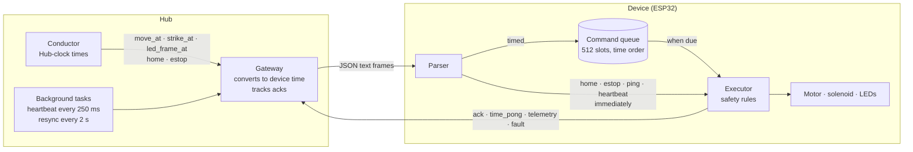
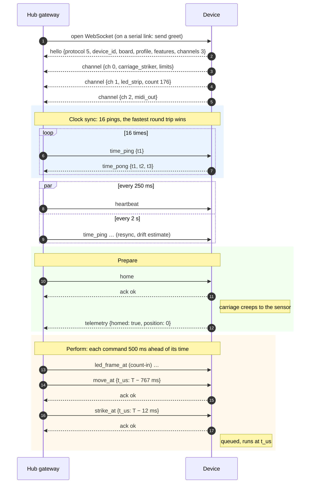
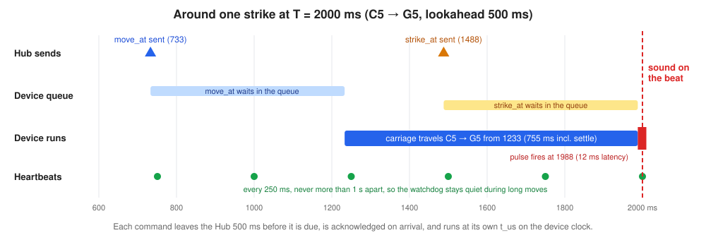
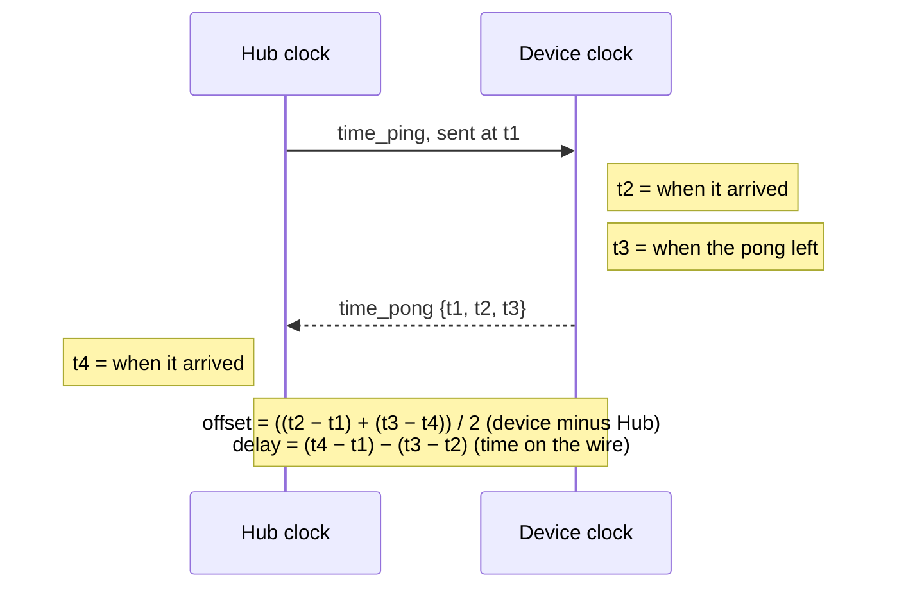
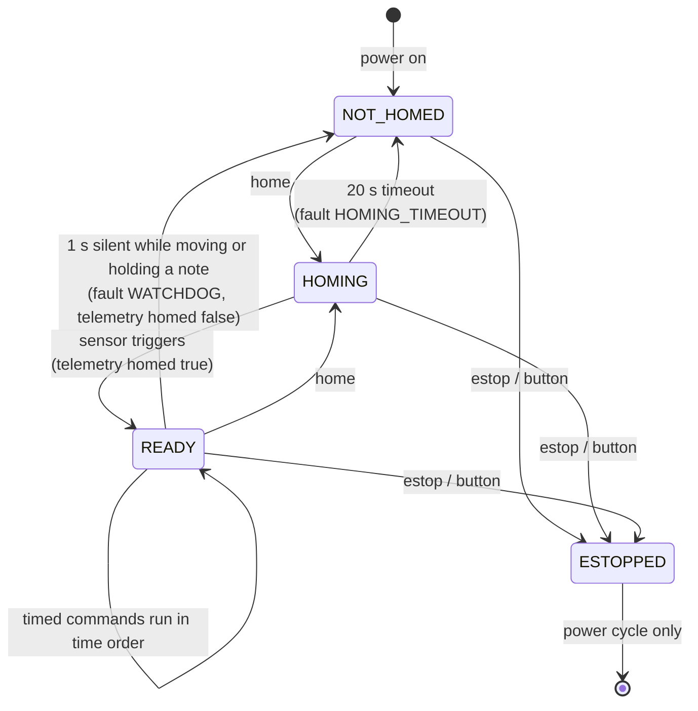
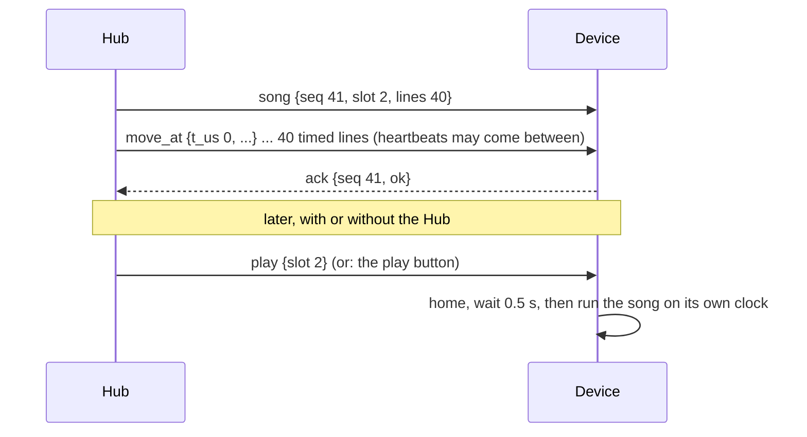
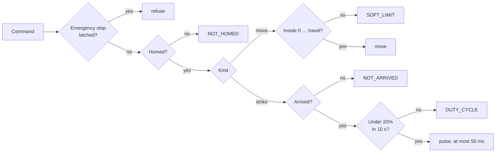

# Device protocol

The contract between the **Hub** (Python, `src/duet/protocol.py`,
`src/duet/device/gateway.py`) and the **rig** (ESP32 firmware,
`firmware/lib/duet_core/`). Both sides must follow this page exactly. The contract test
(`tests/test_firmware_contract.py`) runs the Hub's real command stream through the C++
core and checks that it agrees with the Python simulator.

**Protocol version: 5** (sent by the device in `hello`). Version 3 added channels: the
device describes what it drives, and every timed command names the channel that plays
it. Version 4 added `greet`: on a serial link, which has no "connect", the Hub asks for
the greeting instead of hoping to catch the one sent at boot. Version 5: `stop` also
clears what the Hub has queued, so a live performance can be stopped.

## Channels

A board drives a few things, one **channel** each: today a carriage with its striker
(`carriage_striker`), the LED strip over the keys (`led_strip`) and a MIDI out port
(`midi_out`). The board lists them
(`firmware/boards/<board>/board.h`); the device describes them on connect; every timed
command carries `ch`, and the device refuses a command for a channel it does not have,
or of the wrong kind (`error: no such channel`).

| Kind | Commands | Described with |
|---|---|---|
| `carriage_striker` | `move_at`, `strike_at` | the safety limits it enforces |
| `led_strip` | `led_frame_at` | `count`: its number of LEDs |
| `midi_out` | `note_at` | — (a MIDI out port, 31250 baud) |

The Hub never assumes channel numbers: the conductor sends each message on the target
device's channel of that message's kind. Today's boards have the carriage on 0, the
strip on 1 and MIDI out on 2.

## At a glance



## Transport

| | WebSocket (normal) | USB serial (bench, fallback) |
|---|---|---|
| Where | `ws://<rig>:8765/` on the LAN | 115200 baud, the ESP32's USB port |
| Finding the rig | mDNS: service `_duet._tcp`, host `duet-rig-1.local` | the serial port name |
| Framing | one JSON object per text frame | one JSON object per line (`\n`) |
| Size limit | 255 bytes per message (device buffer) | 255 bytes per line |
| Clients | one Hub at a time; a new connection takes over | — |

The device mirrors everything it sends to serial too, so a serial monitor shows the
whole conversation during bench work.

## Message envelope

Every message is a flat JSON object with a `type` and a `seq`:

```json
{"type":"strike_at","seq":42,"ch":0,"t_us":987654321012,"pulse_us":22000}
```

- **No nesting**, except the `rgb` array. The firmware parser is a small flat-object
  reader with no JSON library.
- **Integers for times**: microseconds, always on the **device's own clock** when on the
  wire. Inside the Hub, times are on the Hub clock; the gateway converts them.
- **`seq`** identifies a message for acknowledgements:

| Who sends it | `seq` values |
|---|---|
| Gateway (every command and clock ping) | 1, 2, 3 ... counting up for the whole connection |
| Device (`hello`, `channel`, `telemetry`, `fault`) | 0 |
| Device (`ack`, `time_pong`) | the `seq` of the message being answered |

The conductor numbers each performance's plan from 0. The gateway puts its **own**
counter on the wire and remembers which plan number each wire `seq` stands for, so two
performances on one connection can never mix up their acknowledgements, and errors are
reported with the plan's number.

## Messages

### Hub → device

| Type | Fields | Timed? | Answer | What the device does |
|---|---|---|---|---|
| `home` | — | no | `ack`, then `telemetry` when homed | Clears the queue, drives toward the sensor, sets position 0 |
| `move_at` | `ch`, `t_us`, `target_steps`, `v_max_mm_s`, `a_max_mm_s2` | yes | `ack` on receipt | At `t_us`, moves the carriage with a trapezoid profile |
| `strike_at` | `ch`, `t_us`, `pulse_us` | yes | `ack` on receipt | At `t_us`, pulses the solenoid, if the carriage has arrived |
| `note_at` | `ch`, `t_us`, `midi` (MIDI channel 0–15), `pitch`, `vel` (0 = note off) | yes | `ack` on receipt | At `t_us`, sends the MIDI note on (or off). Needs no homing |
| `led_frame_at` | `ch`, `t_us`, `first`, `count`, `rgb` | yes | `ack` on receipt | At `t_us`, fills LEDs `first … first+count−1` with `rgb` and shows |
| `estop` | — | no | `ack` | Stops motion, solenoid off, clears the queue, latches |
| `time_ping` | `t1` (Hub clock) | no | `time_pong` | Answers immediately |
| `heartbeat` | — | no | none | Only resets the watchdog |
| `song` | `slot` (0–7), `lines`, `title` (optional: one line, at most 64 bytes) | no | one `ack`, after the last line | The next `lines` timed commands are stored as a song (below) |
| `play` | `slot` | no | `ack` | Homes, then plays the stored song on its own (below) |
| `stop` | — | no | `ack` | Stops playing: a stored song, or the Hub's queued commands (a live performance stopped from the page). Clears the queue, stops the carriage, LEDs and MIDI notes off |
| `greet` | — | no | `hello`, then the `channel`s | The Hub's first message on a serial link (below) |

### Device → Hub

| Type | Fields | When |
|---|---|---|
| `hello` | `protocol`, `device_id`, `board`, `profile`, `features` (list), `channels` (how many) | When a WebSocket connects; on a serial link, in answer to `greet` |
| `channel` | `ch`, `kind`; a carriage: `steps_per_mm`, `travel_steps`, `duty_limit`, `duty_window_us`, `max_pulse_us`; a strip: `count` | Right after `hello`, one per channel |
| `ack` | `status`: `ok` or `error: …` | For every command except `heartbeat` and `time_ping` |
| `time_pong` | `t1`, `t2` (arrived), `t3` (left), device clock | Answer to `time_ping` |
| `telemetry` | `homed`, `position` (steps), `queued` | When homing ends; when position stops being trusted |
| `fault` | `code`, `detail` | When a safety rule refuses or stops something (below) |

### Examples

```json
{"type":"hello","seq":0,"protocol":5,"device_id":"duet-rig-1","board":"esp32-classic","profile":"bottles-v1","features":["wifi","flash","play_button","estop_button","web"],"channels":3}
{"type":"channel","seq":0,"ch":0,"kind":"carriage_striker","steps_per_mm":80.000,"travel_steps":48000,"duty_limit":0.200,"duty_window_us":10000000,"max_pulse_us":50000}
{"type":"channel","seq":0,"ch":1,"kind":"led_strip","count":176}
{"type":"channel","seq":0,"ch":2,"kind":"midi_out","count":0}
{"type":"home","seq":0}
{"type":"ack","seq":0,"status":"ok"}
{"type":"telemetry","seq":0,"homed":true,"position":0,"queued":0}
{"type":"move_at","seq":7,"ch":0,"t_us":5012000345,"target_steps":26800,"v_max_mm_s":500.0,"a_max_mm_s2":5000.0}
{"type":"strike_at","seq":8,"ch":0,"t_us":5012755345,"pulse_us":22000}
{"type":"led_frame_at","seq":9,"ch":1,"t_us":5012767345,"first":93,"count":2,"rgb":[255,255,255]}
{"type":"time_ping","seq":17,"t1":81234567}
{"type":"time_pong","seq":17,"t1":81234567,"t2":1068889101,"t3":1068889102}
{"type":"heartbeat","seq":0}
{"type":"fault","seq":0,"code":"NOT_ARRIVED","detail":"strike before the carriage arrived"}
```

### Units

| Field | Unit | Notes |
|---|---|---|
| `t_us`, `t1`, `t2`, `t3` | µs, 64-bit | device clock on the wire (`esp_timer_get_time()`) |
| `target_steps`, `position` | microsteps from home | `bottles-v1`: 80 steps per mm, 0 … 48 000 |
| `v_max_mm_s`, `a_max_mm_s2` | mm/s, mm/s² | the device converts with its `steps_per_mm` |
| `pulse_us` | µs | the Hub maps velocity 1–127 to 15–30 ms; the device caps at 50 ms |
| `first`, `count` | LED index, LED count | 0 … 175 on the 88-key strip |
| `rgb` | 0–255 each | the device also applies a global brightness limit |

## A session, start to finish



## Timing rules



| Rule | Value | Where |
|---|---|---|
| Lookahead (fixed, wait, jam, ensemble) | 500 ms | `conductor.perform(lookahead_s=0.5)` |
| Lookahead (follow mode) | 150 ms | `conductor.FOLLOW_LOOKAHEAD_US` |
| Start buffer before the count-in | 300 ms | `perform(buffer_s=0.3)` |
| Heartbeat | every 250 ms | `DeviceGateway(heartbeat_every_s=0.25)` |
| Watchdog | 1 s of silence while moving | `Config::watchdog_us` |
| Clock sync at connect | 16 pings | `DeviceGateway(sync_samples=16)` |
| Resync | every 2 s | `DeviceGateway(resync_every_s=2.0)` |
| Target sync error | under 2 ms | tested on localhost and at 2000 ppm drift |
| Device queue | 512 commands | `kQueueSize` |
| Counted as late | over 5 ms | `Config::late_tolerance_us` |
| Homing timeout (device) | 20 s | `Config::homing_timeout_us` |
| Homing wait (Hub) | 30 s | `perform(homing_timeout_s=30)` |
| Gateway request timeout | 5 s | `DeviceGateway(timeout_s=5)` |

Why the heartbeat exists: without it, a long carriage move can come more than 1 s after
the Hub's last command, and the watchdog stops the rig mid-song. The contract test
`test_heartbeats_keep_the_watchdog_quiet` shows both cases.

## Clock sync



- Of the 16 samples, the one with the **smallest delay** wins: it was least disturbed by
  the network, and the true offset is within ±delay/2 of it.
- Every resync also estimates **drift** (how fast the device crystal runs, in ppm), from
  how the offset changes between syncs, smoothed 50/50 with the previous estimate.
- The gateway converts every timed command:
  `device_t = hub_t + offset + drift_ppm × (hub_t − sync_time) / 10⁶`.

## Device state



### How the queue runs

- Timed commands are kept in **time order** (ties by `seq`), whatever order they arrive in.
- Each loop the device runs every command whose `t_us` has passed. A command that is
  already late still runs, and counts as late if more than 5 ms behind.
- `home` and `estop` clear the queue.
- A `strike_at` only fires if the carriage is **not moving and is at the target of the
  last `move_at`**. Otherwise it is refused with `NOT_ARRIVED`.

## Answers and faults

### `ack` statuses

| Status | Meaning | Hub should |
|---|---|---|
| `ok` | Accepted (queued, or done for `home` / `estop`) | nothing |
| `error: cannot parse` | Not valid JSON, unknown type, or missing fields (a timed command without `ch`) | log it; it is a Hub bug |
| `error: no such channel` | A timed command for a channel the device does not have, or of the wrong kind | log it; it is a Hub bug |
| `error: queue full` | 512 commands already waiting | send less far ahead |
| `error: emergency stop` | The rig is latched in emergency stop | stop the performance; a person must power-cycle |
| `error: playing from memory` | A live timed command or an upload while a stored song plays | send `stop` first |
| `error: already playing` | `play` while a stored song plays | send `stop` first |
| `error: no song in that slot` | `play` of an empty slot | upload the song |
| `error: bad song line` / `bad song length` / `bad song slot` | A `song` upload broke a rule below; nothing was stored | fix the upload |
| `error: upload stalled` | No song line for 2 s during an upload; nothing was stored | upload again |
| `error: storage full` | The device's flash is full | upload to a slot already in use |

### What the gateway does with answers

- The gateway refuses a device on another protocol version, then compares its
  carriage channel's limits with the profile the Hub plans with and
  refuses to connect if they differ (`DeviceMismatch`): a score the Hub thinks playable
  would otherwise be refused mid-song.
- `board` and `features` say what this device can do beyond the core (feature names:
  `firmware/lib/duet_core/src/duet_features.hpp`). The Hub and the app decide from the
  features, never from the board's name.
- Any `error: …` ack, a `WATCHDOG` or `HOMING_TIMEOUT` fault, or a lost connection stops
  the performance: every waiting call wakes at once and the next `send` or wait raises
  `DeviceFault`. Other faults are recorded in `gateway.faults` and the music plays on.

### Fault codes

| Code | Cause | Device action | Hub / person should |
|---|---|---|---|
| `NOT_HOMED` | A move or strike before homing | refuses it | send `home` and wait for telemetry |
| `SOFT_LIMIT` | `target_steps` outside 0 … travel | refuses the move | fix the profile's bottle positions |
| `MOVE_OVERLAP` | A move began before the last one ended | starts the new move | the plan is too tight; check the profile's speed numbers |
| `NOT_ARRIVED` | Strike while the carriage was still moving | skips the strike | recalibrate; the real carriage is slower than the profile says |
| `DUTY_CYCLE` | Solenoid over 20% on-time in 10 s | skips the strike | the score is too dense; repair should have caught it |
| `WATCHDOG` | 1 s with no message while moving or holding a MIDI note | stops, silences MIDI, clears the queue, un-homes | check Wi-Fi; re-home and restart |
| `HOMING_TIMEOUT` | The sensor never triggered within 20 s | stops | check the sensor wiring and its distance to the carriage |
| `SONG_CORRUPT` | A stored song line cannot be read back | stops playing | upload the song again |
| `PLAY_FAILED` | A stored command was refused (queue full or e-stop) | stops playing | check the e-stop; upload a less dense song |

## Play from memory

The rig can play a stored song with no Hub: upload once, then press the play button.
The Hub does all the thinking at upload time (`duet upload song.json --device …`,
`duet.songs.compile_song`): the song is the same timed commands a live performance
would send, count-in included, starting from the home position, with `t_us` counted
from the song's start.



Rules the device keeps:

- **Uploading.** Only timed commands count as song lines; heartbeats and clock pings
  in between are handled as usual. Every line must have `0 ≤ t_us ≤ 1 h`. If any line
  is bad, nothing is stored and the slot keeps its old song. At most 4000 lines.
- **Playing.** Always homes first: a song is compiled from the home position. Stored
  commands are queued half a second ahead, exactly as the Hub's conductor sends them,
  so every safety rule (homing, travel, duty cycle, e-stop) still applies. The device
  is its own conductor, so the watchdog does not stop it. The song ends when its last
  move and strike have finished.
- **While playing**, live timed commands and uploads are refused; `home`, `estop` and
  `stop` stop the song first.
- **The play button** plays the next stored song (cycling through the slots); pressed
  during a song, it stops it.
- **Storage.** The rig keeps songs in flash (LittleFS), so they survive power-off. The
  QEMU build and the native device keep them in RAM.

## Safety rules the device keeps on its own

- **MIDI out never hangs a note.** Stopping a song, an emergency stop and the watchdog
  send All Notes Off (controller 123) on all 16 MIDI channels; the watchdog also fires
  when the Hub goes silent while a note is held.

These hold whatever the Hub sends:



Plus: the watchdog, and the emergency-stop button, which the firmware reads every loop.

## Changing the protocol

1. Add the message to `src/duet/protocol.py`. The Python registry picks up every
   `Message` subclass automatically.
2. Add it to the firmware: `Type` and `parse()` in `duet_protocol.hpp/.cpp`, and handle it
   in `Executor::on_message`.
3. Add a round-trip test in `tests/test_device_link.py` and, if it changes what the rig
   does, a case in `tests/test_firmware_contract.py`.
4. Update this page. Raise `protocol` in `hello` for any change an old device would not
   understand.
