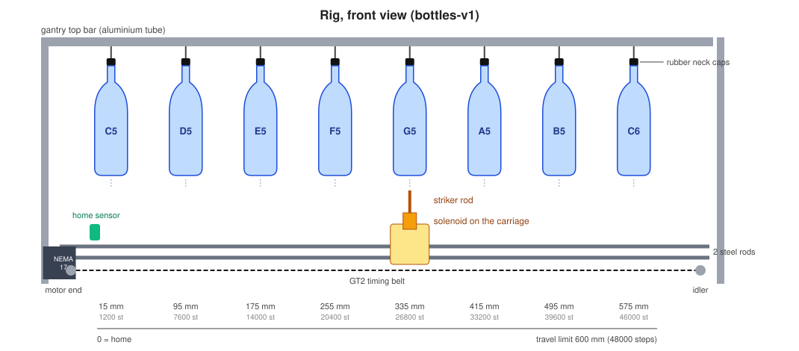
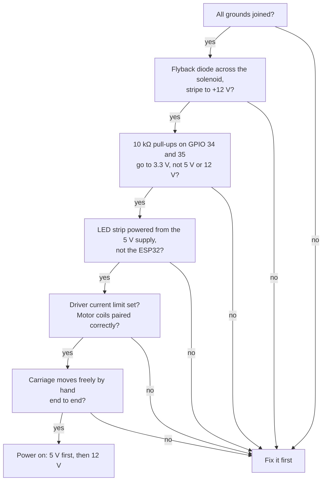
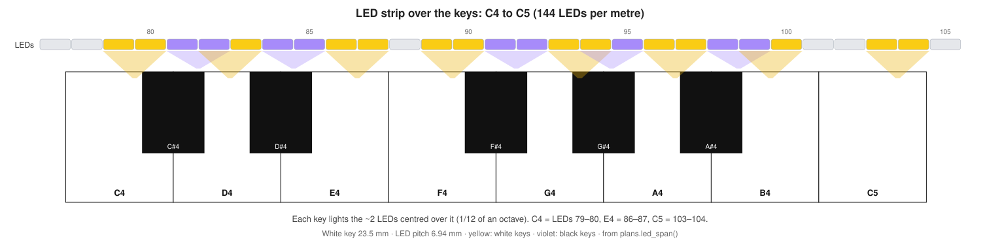
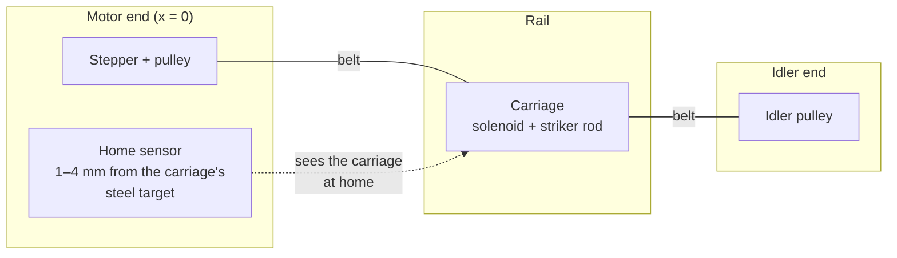
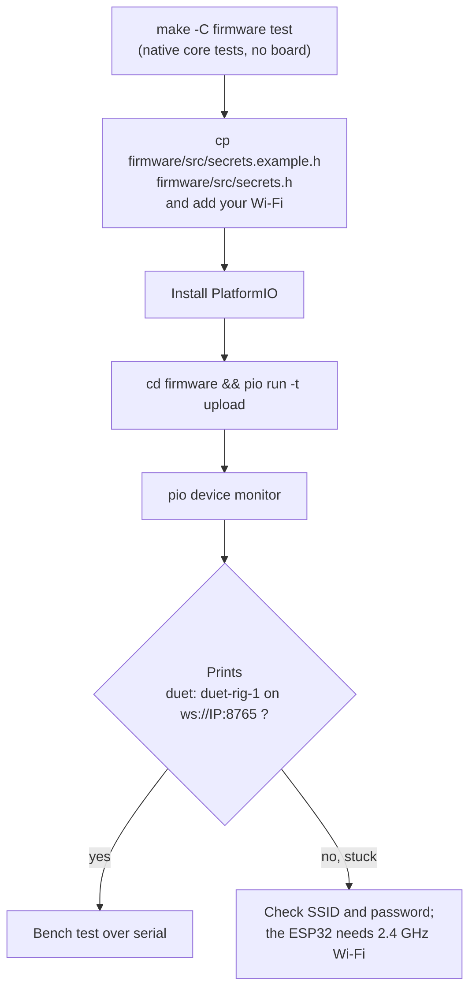
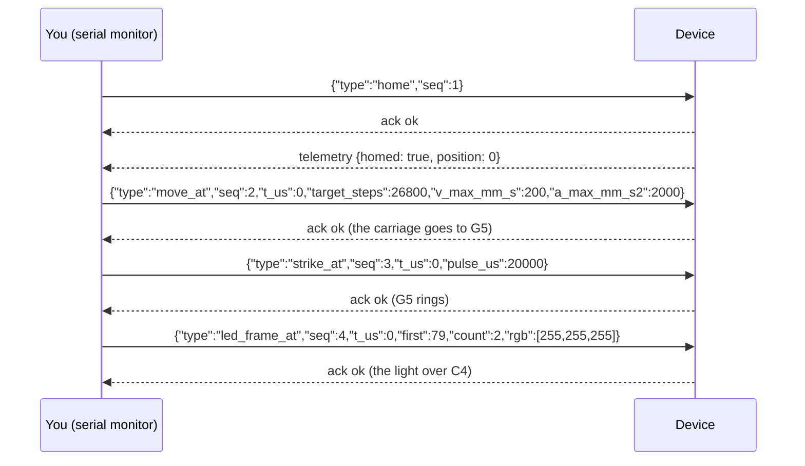
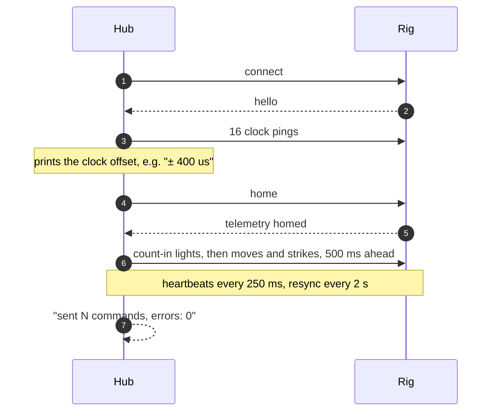
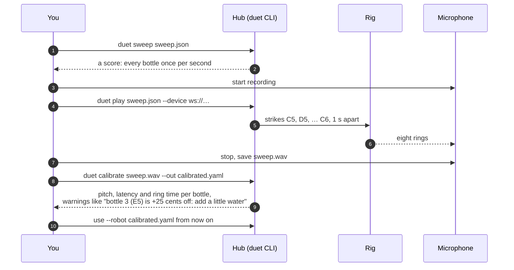
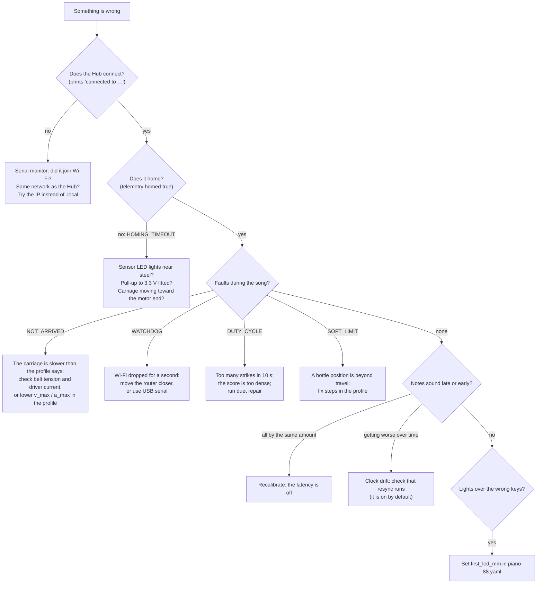
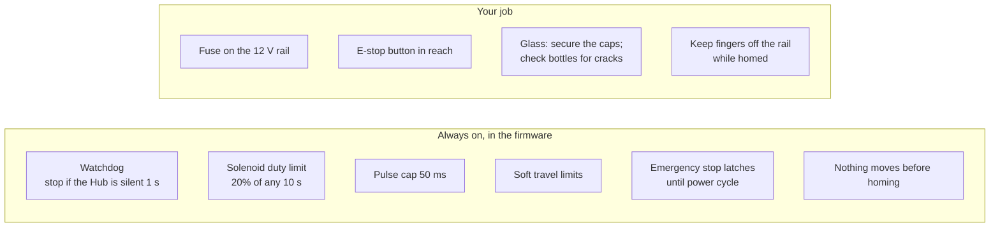

# Rig build and setup guide

How to wire, flash, test, calibrate and run the Duet rig. For what the firmware and the
Hub say to each other, see the [device protocol](device-protocol.md); for how the
software fits together, see the [architecture](architecture.md).

> **Status:** the firmware core is tested natively and against the Hub (contract test),
> but the ESP32 build (`firmware/src/main.cpp`) has **not yet been compiled or run on a
> real board**. Expect to fix small things on first flash. Part numbers below are
> suggestions; equivalents work.

## What you are building



Eight tuned glass bottles hang by their necks from the gantry. A carriage runs on two
steel rods underneath, driven by a stepper motor and a timing belt. A solenoid on the
carriage fires a striker rod up into the bottle above it. An inductive sensor at the
motor end tells the firmware where zero is. One ESP32 runs the carriage, the striker and
the LED strip over the piano.

The bottle positions in the picture come from `src/duet/profiles/bottles-v1.yaml`
(placeholders until calibrated). Regenerate the picture with
`python tools/make_doc_images.py` after you change the profile.

### Parts

| Part | Used for | Notes |
|---|---|---|
| ESP32 DevKit (ESP32-WROOM-32) | the rig's controller | runs `firmware/` |
| NEMA 17 stepper + GT2 belt + 20T pulley + idler | carriage drive | 1/16 microstepping gives 80 steps per mm |
| Stepper driver: TMC2209 (quiet) or A4988 | drives the motor | set the current limit for your motor |
| 2 ground steel rods + linear bearings | carriage guides | |
| JF-1039B push-pull solenoid, 12 V | striker | on the carriage, rod pointing up |
| Logic-level N-MOSFET (IRLZ44N or similar) + 100 Ω + 10 kΩ | switches the solenoid | 10 kΩ gate-to-ground keeps it off at boot |
| Schottky diode (1N5819) | flyback across the solenoid | **required**; protects the MOSFET |
| LJ12A3-4-Z/BX inductive sensor (NPN, normally open) + 10 kΩ | home position | pull-up to 3.3 V, not 12 V |
| Emergency stop button (normally open) + 10 kΩ | stops everything | pull-up to 3.3 V; see the note on GPIO 35 |
| WS2812B strip, 144 LEDs/m, 1.22 m (176 LEDs) | lights over the keys | |
| 74AHCT125 level shifter + 330 Ω | LED data, 3.3 V to 5 V | |
| 1000 µF capacitor | across 5 V at the strip | |
| 12 V supply, 3 A or more, with an inline fuse | motor, solenoid, sensor | |
| 5 V supply, 4 A or more | LED strip | the firmware's brightness cap keeps it within budget |

## Wiring


| ESP32 pin | Goes to | Direction | Notes |
|---|---|---|---|
| GPIO 25 | driver STEP | out | step pulses from FastAccelStepper |
| GPIO 26 | driver DIR | out | if the carriage homes the wrong way, swap one motor coil pair |
| GPIO 27 | driver EN | out | enabled automatically while moving |
| GPIO 32 | MOSFET gate (via 100 Ω) | out | high = solenoid on |
| GPIO 34 | home sensor signal | in | active low (`HOME_ACTIVE_LOW = true`); external 10 kΩ pull-up to 3.3 V |
| GPIO 35 | emergency stop button | in | active low; **external** 10 kΩ pull-up to 3.3 V |
| GPIO 13 | level shifter → strip DIN | out | through 330 Ω at the strip end |
| GND | every ground | — | 12 V, 5 V, driver, MOSFET source, sensor, strip |

> **GPIO 34 and 35 are input-only and have no internal pull-up resistors.** Without the
> external 10 kΩ pull-ups the pins float, and the emergency stop can trip at random or
> never. The firmware sets them as plain inputs and relies on those resistors.

Change pins in `firmware/src/board.h` if your wiring differs.

### Before you power it on



## The LED strip over the keys



- The strip runs along the cabinet edge just above the keys, LED 0 over the left edge of
  the lowest key (A0).
- Each key lights the LEDs centred over it, about two per semitone. The mapping is
  `plans.led_span()`; the picture above is drawn from it.
- If the lights sit a little left or right of the keys, set `first_led_mm` in
  `src/duet/profiles/piano-88.yaml` (millimetres from LED 0 to the left edge of A0).
- Colours: dim white before a note (pre-cue, one beat ahead), bright white to play now,
  blue for the count-in, soft blue over the whole strip for "your turn" in a jam.

## Mechanical setup



- **Homing direction:** on `home`, the carriage drives toward negative steps (the motor
  end) at 4000 steps/s until the sensor triggers. If it runs the other way, swap one
  motor coil pair (or invert DIR).
- **Sensor gap:** the LJ12A3 sees steel at up to about 4 mm. Put a small steel target on
  the carriage. Homing gives up after 20 s with `HOMING_TIMEOUT`.
- **Travel:** the firmware refuses moves outside 0 … 48 000 steps (600 mm). Make sure the
  carriage can really travel that far, or lower `travel_steps` in
  `firmware/lib/duet_core/src/duet_config.hpp` and in the profile.
- **Belt tension:** firm, no slack. A slipping belt shows up as `NOT_ARRIVED` faults or
  strikes that miss the bottle.
- **Bottles:** rubber caps on the necks let the glass ring and stop it swinging. The
  striker should hit the bottom of each bottle squarely when the carriage is at its
  position.

## Flashing the firmware



Commands, in order:

```bash
make -C firmware test
```

```bash
cp firmware/src/secrets.example.h firmware/src/secrets.h
```

```bash
cd firmware && pio run -t upload && pio device monitor
```

`secrets.h` is ignored by git; never commit it.

## Bench test over serial

With the monitor open, type one JSON message per line. A command with `"t_us":0` is
already due, so it runs at once. That makes hand testing easy, though it also counts as
"late" in the device's statistics.



Copy-paste versions:

```json
{"type":"home","seq":1}
{"type":"move_at","seq":2,"t_us":0,"target_steps":26800,"v_max_mm_s":200,"a_max_mm_s2":2000}
{"type":"strike_at","seq":3,"t_us":0,"pulse_us":20000}
{"type":"led_frame_at","seq":4,"t_us":0,"first":79,"count":2,"rgb":[255,255,255]}
{"type":"led_frame_at","seq":5,"t_us":0,"first":0,"count":176,"rgb":[0,0,0]}
```

Wait for each move to finish before sending the strike, or it is refused with
`NOT_ARRIVED`. Use slow speeds (200 mm/s) for first tests. Press the emergency-stop
button once to check it: everything should stop and further commands answer
`error: emergency stop` until you power-cycle.

> Watchdog: on serial there is no Hub sending heartbeats. A move that takes longer than
> 1 s after your last message is stopped with `WATCHDOG`. Send short moves, or any line
> (even `{"type":"heartbeat","seq":0}`) while it moves.

## First performance from the Hub

```bash
duet play examples/rain-on-the-bottles.json --device ws://duet-rig-1.local:8765
```

If `.local` names don't resolve on your network, use the IP address the serial monitor
printed. Rehearse without the rig first, on the simulated device:

```bash
duet device-sim --port 8765
```

```bash
duet play examples/rain-on-the-bottles.json --device ws://127.0.0.1:8765
```



## Calibration

The profile's numbers are placeholders until you measure your rig. Calibration measures
each bottle's real pitch, how long it rings, and the delay from strike command to sound.



```bash
duet sweep sweep.json
```

```bash
duet calibrate sweep.wav --out calibrated.yaml
```

```bash
duet --robot calibrated.yaml play examples/rain-on-the-bottles.json --device ws://duet-rig-1.local:8765
```

### Reading the results

| Result | What it means | What to do |
|---|---|---|
| `bottle N (E5) is +25 cents off: add a little water` | it sounds sharp | add water (lowers a struck bottle's pitch), then sweep again |
| `… -30 cents off: pour out a little water` | it sounds flat | pour a little out, then sweep again |
| `bottle N now sounds G#5, not G5; it was renamed` | more than 50 cents off | retune it, or keep the new note: the profile already uses it |
| `bottle N (C6) was not heard` | no strike in its window | check that bottle's position and the striker |
| latency far above 20 ms | slow solenoid or a far microphone | put the microphone near the bottles; the profile now compensates |

Each run writes a new version (`calibration.version`) with the date, so you can compare.
Warnings start at 15 cents.

### Strike positions

If a bottle sounds dull, the striker may be hitting off-centre. Jog the carriage over
serial (`move_at` with `t_us: 0`) in small steps around that bottle, strike at each one,
and note the position that rings best. Put that in `steps:` in the profile.
`calibration.best_strike_positions()` does this choice for you from a list of
(steps, loudness) measurements.

## Troubleshooting



| Symptom | Likely cause | Check |
|---|---|---|
| ESP32 resets when the solenoid fires | supply dip or missing flyback diode | diode across the coil; separate 12 V and 5 V supplies; common ground |
| Solenoid clicks at power-on | MOSFET gate floating at boot | 10 kΩ gate-to-ground resistor |
| Emergency stop trips by itself | GPIO 35 floating | external 10 kΩ pull-up to 3.3 V |
| First LED wrong colour or flickers | 3.3 V data into a 5 V strip | level shifter; 330 Ω at DIN; short data wire |
| LEDs dim or red at the far end | voltage drop | feed 5 V at both ends of the strip |
| Strikes miss the bottle | belt slip or wrong positions | belt tension; strike positions |
| Motor hot or stalls | driver current too high or too low | set the current limit for your motor |

## Safety



- The solenoid coil heats up if held on. The firmware caps every pulse at 50 ms and keeps
  on-time under 20% of any 10 s. **Do not raise these limits** without measuring the
  coil temperature.
- The emergency stop cuts motion and the solenoid and refuses all commands until power is
  cycled. Consider wiring it to also cut the 12 V rail through a relay.
- Glass can crack if struck too hard. Start with short pulses (15 ms) and raise them only
  as far as the sound needs.
- Children will want to touch it. The carriage moves fast (up to 500 mm/s): keep hands
  away from the rail and belt while the rig is homed.
