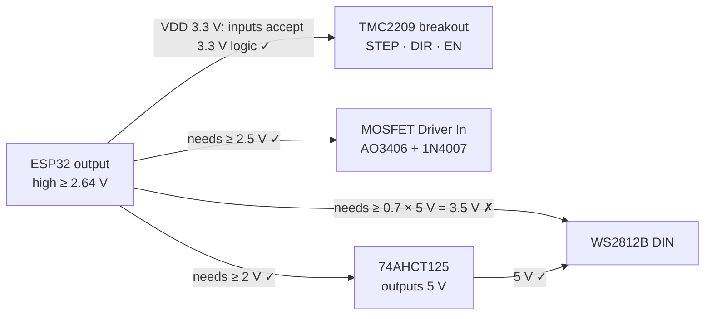
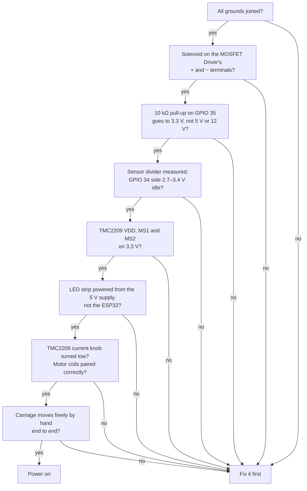
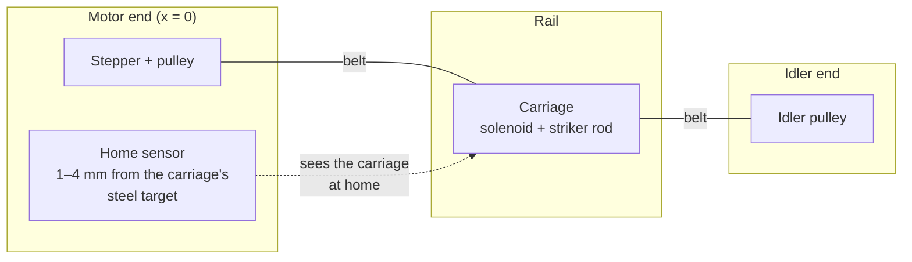
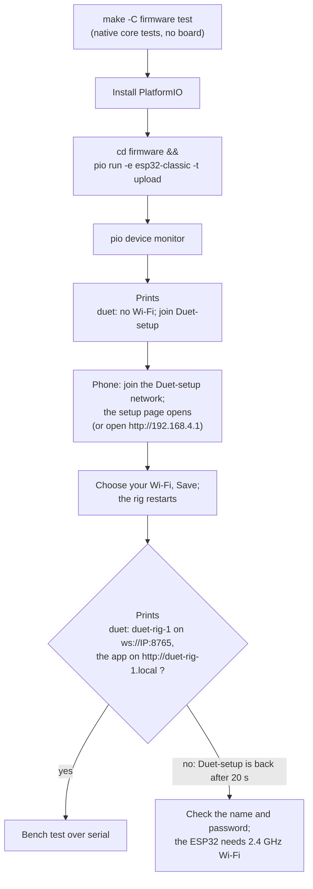
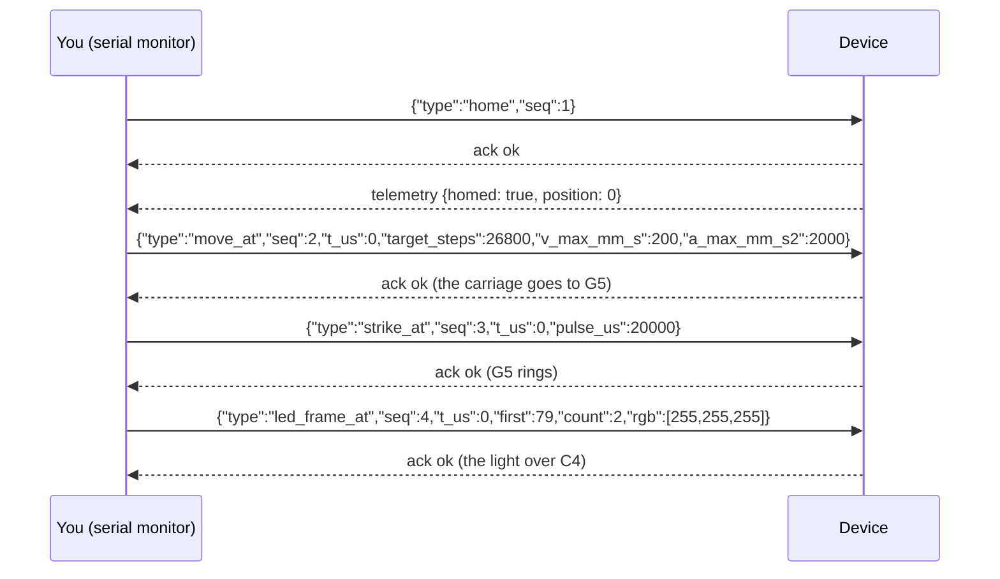
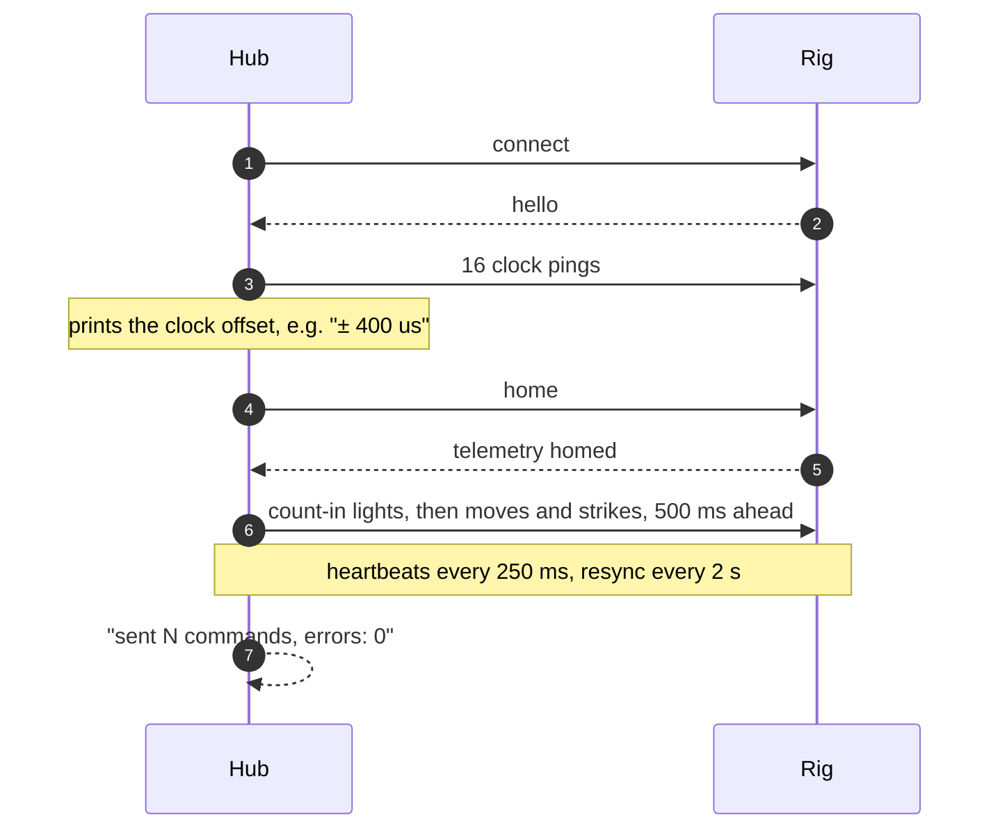
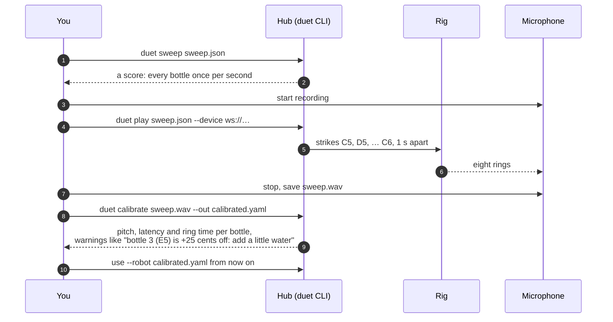
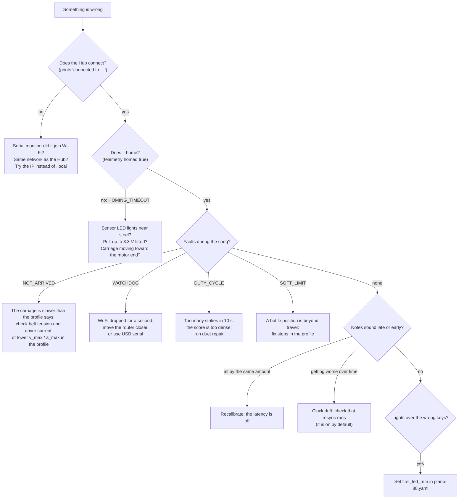
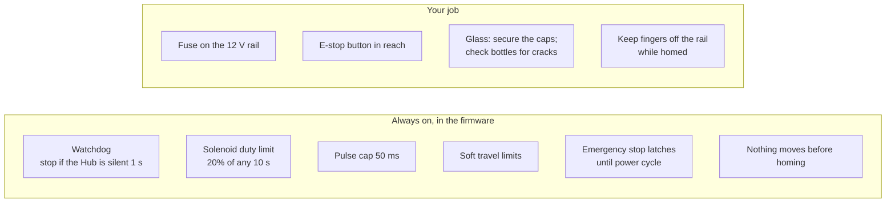

# Rig build and setup guide

How to wire, flash, test, calibrate and run the Duet rig. For what the firmware and the
Hub say to each other, see the [device protocol](device-protocol.md); for how the
software fits together, see the [architecture](architecture.md).

> **Status:** the firmware core is tested natively and against the Hub (contract test),
> but the ESP32 build (`firmware/src/main.cpp`) has **not yet been compiled or run on a
> real board**. Expect to fix small things on first flash. Part numbers below are
> suggestions; equivalents work.

## What you are building


Eight tuned glass bottles hang by their necks from the gantry. A carriage runs on two
steel rods underneath, driven by a stepper motor and a timing belt. A solenoid on the
carriage fires a striker rod up into the bottle above it. An inductive sensor at the
motor end tells the firmware where zero is. One ESP32 runs the carriage, the striker and
the LED strip over the piano.

The bottle positions in the picture come from `src/duet/profiles/bottles-v1.yaml`
(placeholders until calibrated). Regenerate the picture with
`python tools/make_doc_images.py` after you change the profile.

### Parts

Parts marked **ordered** are the Adafruit parts bought for this build; the rest are still
needed. Part numbers in the other rows are suggestions; equivalents work.

| Part | Used for | Notes |
|---|---|---|
| ESP32 DevKit (ESP32-WROOM-32) | the rig's controller | runs `firmware/` |
| NEMA 17 stepper + GT2 belt + 20T pulley + idler | carriage drive | 1/16 microstepping gives 80 steps per mm (200 × 16 steps per 40 mm) |
| **Adafruit TMC2209 Stepper Motor Driver Breakout (#6121)** — ordered | drives the motor | VDD from **3.3 V**; **MS1 and MS2 tied to 3.3 V** for 1/16; motor 5–29 V; current set by the onboard knob (up to 2 A) |
| 2 ground steel rods + linear bearings | carriage guides | |
| JF-1039B push-pull solenoid, 12 V | striker | on the carriage, rod pointing up; about 0.4 A (seller data, no datasheet found) |
| **Adafruit MOSFET Driver (#5648)** — ordered | switches the solenoid | AO3406 MOSFET, 1N4007 flyback diode and an input pull-down built in; 1.5 A continuous |
| **STEMMA JST PH 3-pin to female socket cable (#3894)** — ordered | MOSFET driver to ESP32 and 12 V | V+, GND, In |
| LJ12A3-4-Z/BX inductive sensor (NPN, normally open, 6–36 V) + 4.7 kΩ, 27 kΩ, 10 kΩ | home position | pull-up to 12 V and a divider into GPIO 34; see below |
| Emergency stop button (normally open) + 10 kΩ | stops everything | pull-up to 3.3 V; see the note on GPIO 35 |
| Play button (normally open, any momentary push button) | plays a stored song without a PC | between GPIO 33 and GND; no resistor (internal pull-up) |
| **Adafruit MIDI FeatherWing Kit (#4740)** — optional | MIDI out to a digital piano or synth: a bot can play it | DIN-5 jacks and a 3 V-safe circuit; its TX pad from GPIO 17, 3V and GND (Adafruit's guide: 3.3 V logic, 31250 baud) |
| WS2812B strip, 144 LEDs/m, 1.22 m (176 LEDs) | lights over the keys | |
| 74AHCT125 quad buffer + 330 Ω | LED data, 3.3 V to 5 V | one channel used; the other three tied off |
| 1000 µF capacitor | across 5 V at the strip | |
| **Adafruit 12 V 1 A regulated adapter (#798)** — ordered | motor and solenoid | probably enough; see [power budget](#power-budget). Add an inline fuse |
| 5 V supply, 4 A or more | LED strip, level shifter | size is an estimate; the firmware's brightness cap helps |

Also in the order, for prototyping: breadboard, jumper wires, a micro-B USB cable (for
the ESP32 board, if it has micro-B), 220 Ω resistors, 3 mm LEDs, heat shrink, 4-wire
ribbon cable (motor wires) and a 6-pin JST PH cable pair.

## Wiring


| ESP32 pin | Goes to | Direction | Notes |
|---|---|---|---|
| GPIO 25 | TMC2209 STEP | out | step pulses from FastAccelStepper |
| GPIO 26 | TMC2209 DIR | out | if the carriage homes the wrong way, swap one motor coil pair |
| GPIO 27 | TMC2209 EN | out | active low ("pull high to disable"); enabled automatically while moving |
| GPIO 32 | MOSFET Driver **In** (STEMMA cable) | out | high = solenoid on; the board's pull-down keeps it off during boot |
| GPIO 34 | home sensor, through the divider | in | active low (`HOME_ACTIVE_LOW = true`) |
| GPIO 35 | emergency stop button | in | active low; **external** 10 kΩ pull-up to 3.3 V |
| GPIO 33 | play button, other side to GND | in | active low; internal pull-up; plays the next stored song, or stops it |
| GPIO 17 | MIDI FeatherWing **TX** pad (optional) | out | MIDI out at 31250 baud (UART2); free on a WROOM-32 DevKitC |
| GPIO 13 | 74AHCT125 1A → 1Y → 330 Ω → strip DIN | out | |
| 3V3 | TMC2209 VDD, MS1, MS2, e-stop pull-up | — | |
| GND | every ground | — | 12 V, 5 V, ESP32, TMC2209, MOSFET Driver, sensor, strip |

> **GPIO 34 and 35 are input-only and have no internal pull-up resistors** (ESP32
> datasheet). Without the external resistors the pins float, and the emergency stop can
> trip at random or never. The firmware sets them as plain inputs and relies on those
> resistors.

Change pins in `firmware/boards/esp32-classic/board.h` (or your board's folder) if your wiring differs.

### Why each connection is the way it is

These come from the datasheets and Adafruit's guides (see
[Checked against datasheets](#checked-against-datasheets)).



- **TMC2209 logic at 3.3 V.** Adafruit: give VDD "the same power as the logic level of
  your microcontroller … from 3.3V to 5V". For the ESP32 that is 3.3 V.
- **TMC2209 MS1 and MS2 tied high.** The breakout defaults to **1/8** microstepping with
  both pins open; "if you wanted to use 1/16 microstep mode, you would tie both MS1 and
  MS2 high". The firmware's 80 steps per mm assumes 1/16. With them open, every move goes
  **twice** too far.
- **TMC2209 EN is active low.** "Pull this pin high to disable the output to the motors."
  The firmware drives it low while moving.
- **TMC2209 current.** Turn the onboard knob to set the motor current (up to 2 A, fully
  clockwise). Start low; more current means more heat and more draw from the 12 V adapter.
- **MOSFET Driver from GPIO 32 directly.** Its input takes "between 2.5V and 20V", and the
  ESP32 gives at least 2.64 V. The board's own schematic has a pull-down on the input
  (so the solenoid stays off while the ESP32 boots) and a flyback diode across the output.
  Wire the solenoid to the output's **+** and **−** terminals; **−** is switched to ground
  when In is high.
- **74AHCT125 tidy-up.** Only channel 1 is used (LED data). Its output enable 1OE is
  active low: tie it to GND. Unused inputs must not float: tie 2A, 3A and 4A to GND, and
  2OE, 3OE and 4OE to 5 V.
- **Home sensor through a divider.** The sensor's sheet gives only "NPN, sink, 6–36 V",
  not its output circuit, and some modules have an internal pull-up to their own supply.
  So the output is pulled up to 12 V (4.7 kΩ) and divided down (27 kΩ / 10 kΩ). The sheet
  gives no output-low voltage either, which is why the triggered case is a condition:

  | Sensor state | GPIO 34 voltage | ESP32 needs |
  |---|---|---|
  | idle, 11.4 V supply, no internal pull-up | 11.4 × (37 / 41.7) × (10 / 37) = **2.73 V** | high ≥ 2.475 V |
  | idle, 12.6 V supply, strong internal pull-up | 12.6 × (10 / 37) = **3.40 V** | at most 3.6 V |
  | triggered (output sinking) | V_low × 10 / 37: **under 0.825 V while the sensor's low output is under 3 V** | low ≤ 0.825 V |

  **Measure before connecting:** power the sensor, hold steel near it and away from it,
  and check GPIO 34's side of the divider reads in those ranges before you plug it in.

### Power budget

The 12 V 1 A adapter feeds the motor (through the TMC2209) and the solenoid.

- **Solenoid:** about 0.4 A (seller data), but only for each 15–30 ms strike, and the
  firmware keeps it on under 20% of any 10 s.
- **Motor:** depends on your motor and the current knob. A chopper driver draws less from
  the supply than the coil current, but how much less is not in any datasheet here.

So 1 A is probably enough with a moderate current setting. Check it: set the knob low,
run a dense piece (`duet play … --device …`), and watch for the ESP32 resetting or the
motor losing steps (`NOT_ARRIVED`). If either happens, lower the motor current or use a
bigger 12 V supply. The LED strip is on its own 5 V supply.

### Before you power it on



### Alternatives

The design was first checked with discrete parts. Those notes still hold if you build it
that way:

- **A4988 instead of the TMC2209:** power its VDD from 3.3 V (inputs need 0.7 × VDD);
  tie MS1, MS2 and MS3 to 3.3 V (internal pull-downs, otherwise full steps: 16 times too
  far); tie SLEEP and RESET to 3.3 V.
- **Discrete MOSFET instead of the MOSFET Driver:** the IRLZ44N's on-resistance is only
  specified from VGS 4 V, so drive its gate at 5 V (for example from a spare 74AHCT125
  channel, through 220 Ω), add 10 kΩ gate-to-ground, and put a 1N5819 flyback diode
  across the solenoid, stripe to +12 V.

## The LED strip over the keys


- The strip runs along the cabinet edge just above the keys, LED 0 over the left edge of
  the lowest key (A0).
- Each key lights the LEDs centred over it, about two per semitone. The mapping is
  `plans.led_span()`; the picture above is drawn from it.
- If the lights sit a little left or right of the keys, set `first_led_mm` in
  `src/duet/profiles/piano-88.yaml` (millimetres from LED 0 to the left edge of A0).
- Colours: dim white before a note (pre-cue, one beat ahead), bright white to play now,
  blue for the count-in, soft blue over the whole strip for "your turn" in a jam.

## Mechanical setup



- **Homing direction:** on `home`, the carriage drives toward negative steps (the motor
  end) at 4000 steps/s until the sensor triggers. If it runs the other way, swap one
  motor coil pair (or invert DIR).
- **Sensor gap:** the LJ12A3 sees steel at up to about 4 mm. Put a small steel target on
  the carriage. Homing gives up after 20 s with `HOMING_TIMEOUT`.
- **Travel:** the firmware refuses moves outside 0 … 48 000 steps (600 mm). Make sure the
  carriage can really travel that far, or lower `travel_steps` in
  `firmware/lib/duet_core/src/duet_config.hpp` and in the profile.
- **Belt tension:** firm, no slack. A slipping belt shows up as `NOT_ARRIVED` faults or
  strikes that miss the bottle.
- **Bottles:** rubber caps on the necks let the glass ring and stop it swinging. The
  striker should hit the bottom of each bottle squarely when the carriage is at its
  position.

### Building on an ESP32-S3 instead

The same rig runs on an **ESP32-S3-DevKitC-1 N16R8** (16 MB flash, 8 MB PSRAM), which
has room for everything planned (docs/design/esp-first.md). Only the pins change; they
are in `firmware/boards/esp32-s3/board.h`:

| Signal | ESP32 classic | ESP32-S3 | Notes on the S3 |
|---|---|---|---|
| STEP | GPIO 25 | GPIO 4 | |
| DIR | GPIO 26 | GPIO 5 | |
| EN | GPIO 27 | GPIO 6 | |
| Solenoid (MOSFET Driver In) | GPIO 32 | GPIO 7 | |
| Home sensor (through the divider) | GPIO 34 | GPIO 15 | |
| Emergency stop | GPIO 35 | GPIO 16 | internal pull-up: the external 10 kΩ is not needed |
| Play button | GPIO 33 | GPIO 17 | |
| LED strip (through the 74AHCT125) | GPIO 13 | GPIO 18 | |
| MIDI out (FeatherWing TX pad) | GPIO 17 | GPIO 8 | |

Not usable on the N16R8 (Espressif's DevKitC-1 user guide): GPIO 35–37 (taken by the
octal PSRAM), GPIO 38 (the on-board RGB LED), GPIO 19–20 (USB, kept free for a MIDI
keyboard). Strapping pins 0, 3, 45 and 46 are avoided. Logic levels are 3.3 V, as on the
classic board, so the divider, the 74AHCT125 and the MOSFET Driver are unchanged.

## Flashing the firmware



The first time, the rig has no Wi-Fi to join, so it opens its own open network,
`Duet-setup`. Join it from a phone, and the setup page opens by itself, as at a hotel or
café; if it does not, open `http://192.168.4.1`. Choose your Wi-Fi network and save. The
rig restarts and joins it.

If the rig cannot join within 20 seconds (a wrong password, or the router is still
starting), `Duet-setup` opens again. The rig keeps trying the saved network meanwhile,
and closes `Duet-setup` as soon as it has joined.

The rig's own page is at `http://duet-rig-1.local`. Open it from a phone or laptop on the
same network. It shows what the board can do, plays the songs stored on the rig, has
an emergency stop, and holds the settings (docs/device-api.md).

Commands, in order:

```bash
make -C firmware test
```

```bash
cd firmware && pio run -e esp32-classic -t upload && pio device monitor
```

On an ESP32-S3, use `-e esp32-s3`. To plan MIDI files on the rig with no server, build with the optional planner module: `-e esp32-classic-planner` (or `esp32-s3-planner`; docs/device-api.md).

## Bench test over serial

With the monitor open, type one JSON message per line. A command with `"t_us":0` is
already due, so it runs at once. That makes hand testing easy, though it also counts as
"late" in the device's statistics.



Copy-paste versions:

```json
{"type":"home","seq":1}
{"type":"move_at","seq":2,"t_us":0,"target_steps":26800,"v_max_mm_s":200,"a_max_mm_s2":2000}
{"type":"strike_at","seq":3,"t_us":0,"pulse_us":20000}
{"type":"led_frame_at","seq":4,"t_us":0,"first":79,"count":2,"rgb":[255,255,255]}
{"type":"led_frame_at","seq":5,"t_us":0,"first":0,"count":176,"rgb":[0,0,0]}
```

Wait for each move to finish before sending the strike, or it is refused with
`NOT_ARRIVED`. Use slow speeds (200 mm/s) for first tests. Press the emergency-stop
button once to check it: everything should stop and further commands answer
`error: emergency stop` until you power-cycle.

> Watchdog: on serial there is no Hub sending heartbeats. A move that takes longer than
> 1 s after your last message is stopped with `WATCHDOG`. Send short moves, or any line
> (even `{"type":"heartbeat","seq":0}`) while it moves.

## First performance from the Hub

```bash
duet play examples/rain-on-the-bottles.json --device ws://duet-rig-1.local:8765
```

If `.local` names don't resolve on your network, use the IP address the serial monitor
printed. Rehearse without the rig first, on the simulated device:

```bash
duet device-sim --port 8765
```

```bash
duet play examples/rain-on-the-bottles.json --device ws://127.0.0.1:8765
```



## Calibration

The profile's numbers are placeholders until you measure your rig. Calibration measures
each bottle's real pitch, how long it rings, and the delay from strike command to sound.



```bash
duet sweep sweep.json
```

```bash
duet calibrate sweep.wav --out calibrated.yaml
```

```bash
duet --robot calibrated.yaml play examples/rain-on-the-bottles.json --device ws://duet-rig-1.local:8765
```

### Reading the results

| Result | What it means | What to do |
|---|---|---|
| `bottle N (E5) is +25 cents off: add a little water` | it sounds sharp | add water (lowers a struck bottle's pitch), then sweep again |
| `… -30 cents off: pour out a little water` | it sounds flat | pour a little out, then sweep again |
| `bottle N now sounds G#5, not G5; it was renamed` | more than 50 cents off | retune it, or keep the new note: the profile already uses it |
| `bottle N (C6) was not heard` | no strike in its window | check that bottle's position and the striker |
| latency far above 20 ms | slow solenoid or a far microphone | put the microphone near the bottles; the profile now compensates |

Each run writes a new version (`calibration.version`) with the date, so you can compare.
Warnings start at 15 cents.

### Strike positions

If a bottle sounds dull, the striker may be hitting off-centre. Jog the carriage over
serial (`move_at` with `t_us: 0`) in small steps around that bottle, strike at each one,
and note the position that rings best. Put that in `steps:` in the profile.
`calibration.best_strike_positions()` does this choice for you from a list of
(steps, loudness) measurements.

## Troubleshooting



| Symptom | Likely cause | Check |
|---|---|---|
| ESP32 resets when the solenoid fires | supply dip | separate 12 V and 5 V supplies; common ground; see the power budget |
| Carriage moves twice as far as it should | TMC2209 in its default 1/8 mode | MS1 and MS2 tied to 3.3 V |
| Motor does not move at all | TMC2209 disabled, or no current | EN low; current knob not fully counter-clockwise; 12 V on the motor terminals |
| ESP32 resets when the solenoid fires or the motor accelerates | 12 V adapter overloaded | lower the TMC2209 current, or a bigger 12 V supply; see the power budget |
| Solenoid never fires | wrong terminals or no V+ | solenoid on + and −; 12 V on the MOSFET Driver's V+; its Sig LED lights when GPIO 32 is high |
| Emergency stop trips by itself | GPIO 35 floating | external 10 kΩ pull-up to 3.3 V |
| First LED wrong colour or flickers | 3.3 V data into a 5 V strip | level shifter; 1OE to GND; 330 Ω at DIN; short data wire |
| LEDs dim or red at the far end | voltage drop | feed 5 V at both ends of the strip |
| Strikes miss the bottle | belt slip or wrong positions | belt tension; strike positions |
| Motor hot or stalls | driver current too high or too low | set the current limit for your motor |

## Safety



- The solenoid coil heats up if held on. The firmware caps every pulse at 50 ms and keeps
  on-time under 20% of any 10 s. **Do not raise these limits** without measuring the
  coil temperature.
- The emergency stop cuts motion and the solenoid and refuses all commands until power is
  cycled. Consider wiring it to also cut the 12 V rail through a relay.
- Glass can crack if struck too hard. Start with short pulses (15 ms) and raise them only
  as far as the sound needs.
- Children will want to touch it. The carriage moves fast (up to 500 mm/s): keep hands
  away from the rail and belt while the rig is homed.

## Checked against datasheets

The wiring above was checked against these documents (downloaded from the makers' own
sites, except the sensor sheet, which is a distributor's):

| Part | Source | What was checked |
|---|---|---|
| ESP32 | [ESP32 Series Datasheet](https://www.espressif.com/sites/default/files/documentation/esp32_datasheet_en.pdf) (Espressif) | GPIO 34–39 input-only with no pull-ups; strapping pins 0, 2, 5, 12, 15 (none used); input high ≥ 0.75 × VDD, low ≤ 0.25 × VDD, max VDD + 0.3 V; output high ≥ 0.8 × VDD |
| Adafruit TMC2209 breakout (#6121) | [product page](https://www.adafruit.com/product/6121), [learn guide](https://learn.adafruit.com/adafruit-tmc2209-stepper-motor-driver-breakout-board) (Adafruit) | VDD 3–5 V; motor 5–29 V; default 1/8, MS1 and MS2 high = 1/16; EN high disables; current knob up to 2 A |
| Adafruit MOSFET Driver (#5648) | [product page](https://www.adafruit.com/product/5648), [learn guide](https://learn.adafruit.com/adafruit-mosfet-driver) with schematic (Adafruit) | In accepts 2.5–20 V; V+ 3–30 V; AO3406 + 1N4007; pull-down on the input (schematic R2); 1.5 A continuous, 3 A peak; JST PH 2 A |
| Adafruit 12 V 1 A adapter (#798) | [product page](https://www.adafruit.com/product/798) (Adafruit) | regulated 12 V, up to 1 A; 5.5/2.1 mm barrel, positive tip |
| A4988 (alternative) | [A4988 datasheet](https://www.allegromicro.com/-/media/files/datasheets/a4988-datasheet.pdf) (Allegro) | microstep table (all high = 1/16); MSx pull-downs; ENABLE active low; SLEEP and RESET; VDD 3–5.5 V; input high ≥ 0.7 × VDD; VBB 8–35 V; STEP ≥ 1 µs; I = VREF / (8 × Rs) |
| 74AHCT125 | [SN74AHCT125](https://www.ti.com/lit/ds/symlink/sn74ahct125.pdf) (Texas Instruments) | VCC 4.5–5.5 V; input high ≥ 2 V; OE active low; output ±25 mA; unused inputs tied |
| IRLZ44N (alternative) | [IRLZ44NPbF](https://www.infineon.com/dgdl/irlz44npbf.pdf?fileId=5546d462533600a40153567217c32725) (Infineon) | Rds(on) given at VGS 10, 5 and 4 V only; threshold 1–2 V; VGS max ±16 V |
| WS2812B | [WS2812B](https://cdn-shop.adafruit.com/datasheets/WS2812B.pdf) (Worldsemi, hosted by Adafruit) | supply 3.5–5.3 V (absolute maximum); DIN high ≥ 0.7 × VDD; current per LED not given |
| 1N5819 (alternative) | [1N5817–1N5819](https://www.onsemi.com/pdf/datasheet/1n5817-d.pdf) (onsemi) | 40 V reverse, 1 A average |
| LJ12A3-4-Z/BX | [distributor sheet](https://www.electrokit.com/upload/product/41014/41014825/LJ12A3-4.pdf) (Electrokit) | 6–36 V, NPN normally open, sink output, 4 mm range, wire colours; **output circuit not documented** |

**Not verified:**
- **TMC2209 chip datasheet:** Analog Devices' site refused automated downloads, so the
  checks above rely on Adafruit's guide for its breakout, which is the board's own
  documentation.
- **JF-1039B solenoid:** no manufacturer datasheet found. The ~0.4 A figure comes from
  seller listings.
- **Supply sizes:** whether the 12 V 1 A adapter is enough depends on the motor and the
  current setting (see [power budget](#power-budget)); the 5 V 4 A figure is an estimate.
- **Nothing has been built yet.** These checks are on paper; measure before connecting.
