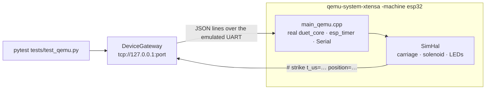

# Testing the firmware on an emulated ESP32 (QEMU)

[Espressif's QEMU](https://github.com/espressif/qemu) emulates the ESP32's CPU, clock,
flash and serial port. `tests/test_qemu.py` boots the **compiled ESP32 firmware** in it
and plays a score through the Hub's `DeviceGateway`, exactly as on the rig, then checks
every strike: the right bottle, at the right time.



## What it tests, and what it does not

| Tested on the emulated chip | Not tested here |
|---|---|
| The core compiled for the ESP32 (Xtensa, the Arduino-ESP32 framework) | The motor, solenoid and LED drivers: QEMU has no stepper or RMT hardware, so `SimHal` stands in |
| The device clock (`esp_timer`) and the Hub's clock sync against it | Wi-Fi and the WebSocket server (use Wokwi, see WOKWI.md, or the rig) |
| The serial link, message parsing and size limits on the chip | Real-world timing jitter |
| Homing, queueing, timed strikes, faults, e-stop, end to end with the Hub | |

The ladder, fastest first: `make -C firmware test` (the core, natively, in a second) →
`tests/test_firmware_contract.py` (the core against the Hub's simulator) → **QEMU** (the
real image on an emulated chip) → Wokwi (the full firmware with Wi-Fi and parts) → the rig.

## Run it

```bash
make qemu-test
```

That builds `firmware/build/qemu-flash.bin` (`make -C firmware qemu-image`, needs
PlatformIO) and runs `tests/test_qemu.py`. The test finds QEMU on `PATH` as
`qemu-system-xtensa`, or at `DUET_QEMU`.

### Getting QEMU

ESP-IDF installs it with `python $IDF_PATH/tools/idf_tools.py install qemu-xtensa`.
Without ESP-IDF, download the build listed for your platform in ESP-IDF's
[`tools/tools.json`](https://github.com/espressif/esp-idf/blob/master/tools/tools.json)
(tool `qemu-xtensa`), check its `sha256`, unpack it and point `DUET_QEMU` at
`qemu/bin/qemu-system-xtensa`. On Debian or Ubuntu it needs
`apt-get install libsdl2-2.0-0 libslirp0 libpixman-1-0 libgcrypt20`.

### Run it by hand

```bash
qemu-system-xtensa -machine esp32 -display none -monitor none \
  -drive file=firmware/build/qemu-flash.bin,if=mtd,format=raw \
  -serial tcp:127.0.0.1:5555,server=on,wait=on
duet play examples/rain-on-the-bottles.json --device tcp://127.0.0.1:5555
```

`tcp://` works for any serial port exposed over TCP, including a real board through
`esp_rfc2217_server` or ser2net.
