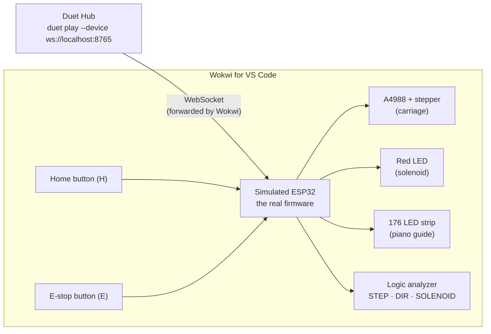

# Running the firmware in the Wokwi simulator

[Wokwi](https://docs.wokwi.com) simulates an ESP32 together with the parts around it.
With it you can run the real firmware (`src/main.cpp` and the core in `lib/duet_core`)
and drive it from the Hub, with no rig on the desk.



## What is simulated, and how

| On the rig | In the simulator | Notes |
|---|---|---|
| ESP32 DevKit | `board-esp32-devkit-c-v4` | Same pins as `src/board.h` |
| TMC2209 driver | `wokwi-a4988` | Wokwi has no TMC2209. Both take STEP/DIR/ENABLE, and the firmware only uses those. Set to 1/16 microstepping, like the rig |
| NEMA 17 + belt carriage | `wokwi-stepper-motor` | Shows the step count. There is no belt: 80 steps = 1 mm |
| Solenoid + MOSFET driver | red LED on pin 32 | Lights for each strike pulse (15 to 30 ms) |
| LJ12A3 home sensor | virtual sensor in firmware, plus a button | See below |
| E-stop button | red button on pin 35, key **E** | Latches the e-stop, as on the rig: restart the simulation to clear it |
| LED strip | `wokwi-led-strip`, 176 pixels on pin 13 | |
| Wi-Fi network | `Wokwi-GUEST` | Open network on channel 6 |

**The home sensor.** Nothing in the simulator moves past the sensor. So the `wokwi`
build (`-DDUET_WOKWI`) tracks the carriage's true distance from the home end. At
power-on the carriage is `WOKWI_START_STEPS` (4000) steps from home, and the sensor
trips when the carriage reaches the end. The yellow button (key **H**) is wired like the
real sensor and also works.

These two `#ifdef DUET_WOKWI` blocks in `main.cpp` and the settings in `src/wokwi.h`
are the only differences from the rig build. Every decision is made by the same
`duet_core` that `make test` checks.

## Setup (once)

1. Install [VS Code](https://code.visualstudio.com), the PlatformIO extension and the
   [Wokwi extension](https://docs.wokwi.com/vscode/getting-started).
2. Run **Wokwi: Request a New License** from the command palette (F1) and sign in. A
   Wokwi account is free.
3. Open the `firmware/` folder in VS Code. Wokwi reads `wokwi.toml` and `diagram.json`
   from there.

The `wokwi` build does not need `src/secrets.h`.

## Run it

1. Build the simulator firmware:

   ```bash
   pio run -e wokwi
   ```

2. Press F1 and run **Wokwi: Start Simulator**. Keep the simulator tab visible: a
   hidden tab can pause the simulation. The serial monitor shows
   `duet: duet-rig-1 on ws://...`.
3. On the same computer, play a score against it. `wokwi.toml` forwards
   `localhost:8765` to the simulated ESP32:

   ```bash
   duet play examples/rain-on-the-bottles.json --device ws://localhost:8765
   ```

   Watch the stepper count move between bottle positions, the red LED flash on each
   strike, and the strip light the keys.

## Things to try

- **E-stop:** press **E** during a song. The Hub stops with a `DeviceFault`
  (`error: emergency stop`).
- **Watchdog:** stop the Hub (Ctrl+C) while the carriage is moving. After 1 s the device
  stops, sends a `WATCHDOG` fault and needs homing again.
- **Timing:** when the simulation stops, the logic analyzer writes `wokwi.vcd`. Open it
  in [Surfer](https://surfer-project.org), PulseView or GTKWave and measure strike pulse
  lengths and the gaps between them.
- **Limits:** the Hub checks the limits in the device's `hello` against the profile. To
  see a mismatch, change `travel_steps` in `lib/duet_core/src/duet_config.hpp` and
  rebuild. Connecting is then refused with `DeviceMismatch`.

## Limits of the simulation

- Timing is the simulator's, not a real ESP32's. Real Wi-Fi jitter is not simulated, so
  confirm timing on the rig.
- The stepper has no inertia, so lost steps and a carriage that is slower than the
  profile cannot happen here. Calibration needs the real rig.
- No sound: the red LED shows when a strike fires, not whether a bottle rang.
